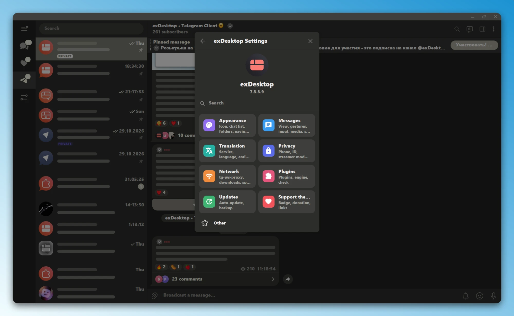
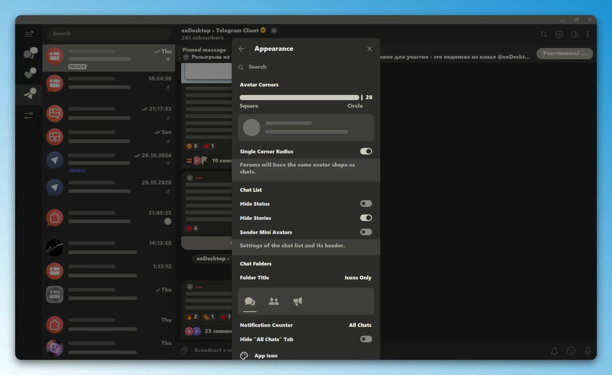
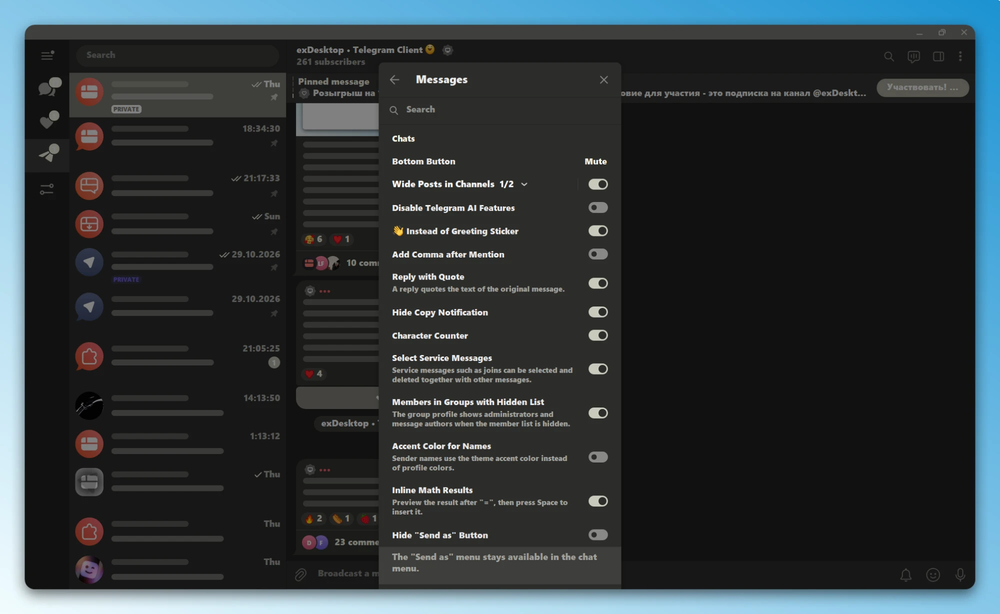
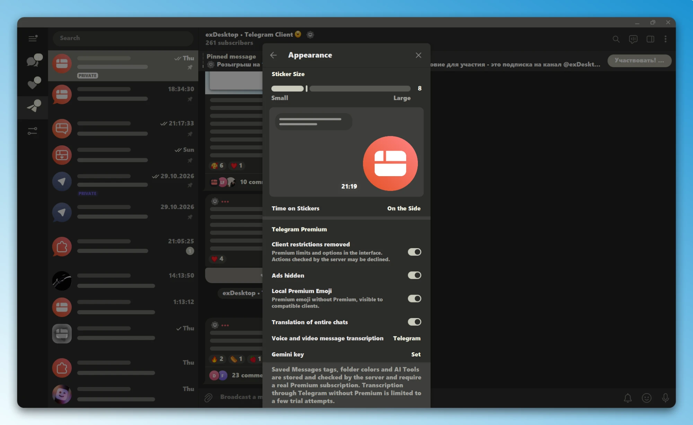
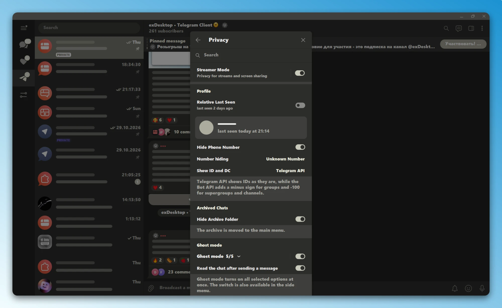
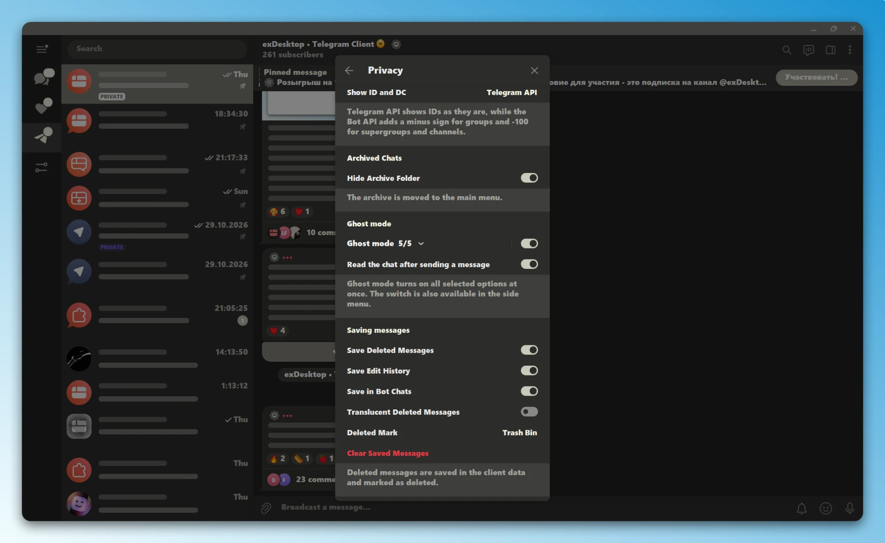
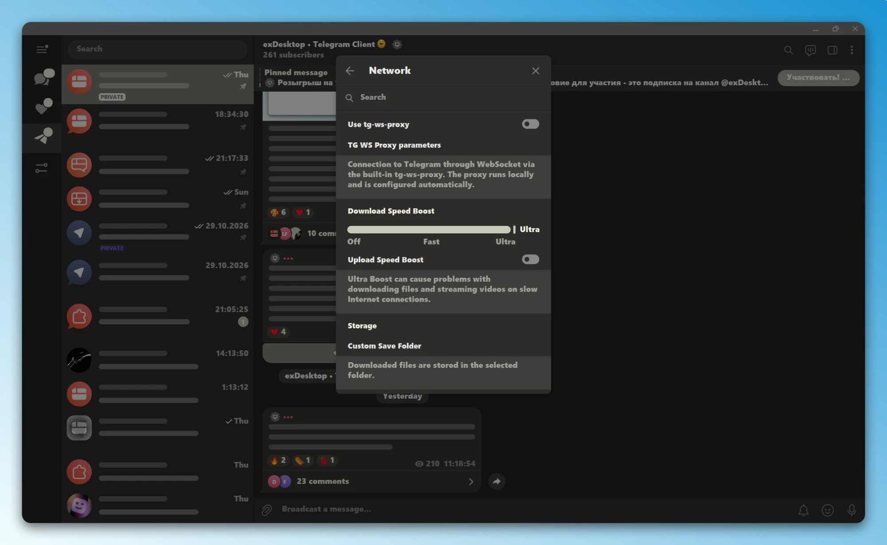
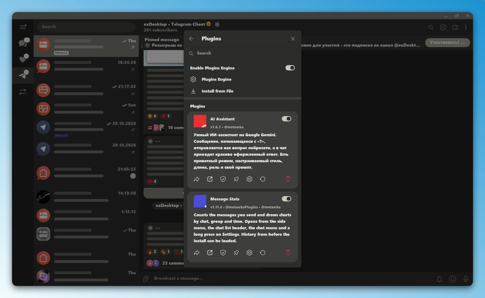
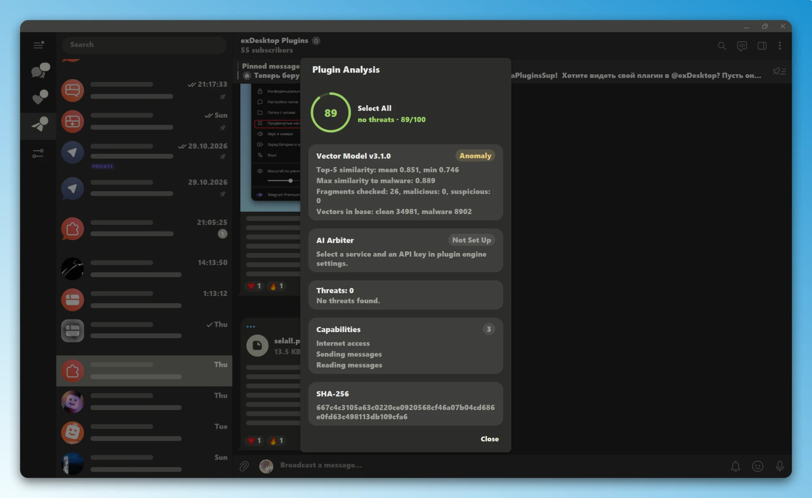
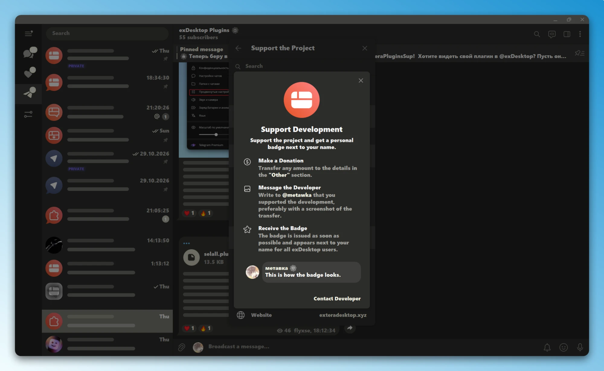

<p align="center">
  <a href="https://github.com/metawka/exDesktop/stargazers"></a>
</p>

<p align="center">
  
</p>

<h1 align="center">exDesktop</h1>

<p align="center">
  Unofficial Telegram client for Windows, Linux and macOS, built from the official
  <a href="https://github.com/telegramdesktop/tdesktop">Telegram Desktop</a> sources.<br>
  Features from exteraGram and other community clients, adapted for Desktop.
</p>

<p align="center">
  <a href="https://github.com/metawka/exDesktop/releases/latest"></a>
  <a href="https://github.com/metawka/exDesktop/releases"></a>
  <a href="LICENSE"></a>
  <br>
  <a href="https://t.me/exDesktop"></a>
  <a href="https://t.me/exDesktopChat"></a>
  <a href="https://exteradesktop.xyz"></a>
</p>

<p align="center">
  
  <a href="README.ru.md"></a>
</p>

<table>
  <tr>
    <td width="50%"></td>
    <td width="50%"></td>
  </tr>
  <tr>
    <td width="50%"></td>
    <td width="50%"></td>
  </tr>
  <tr>
    <td width="50%"></td>
    <td width="50%"></td>
  </tr>
  <tr>
    <td width="50%"></td>
    <td width="50%"></td>
  </tr>
  <tr>
    <td width="50%"></td>
    <td width="50%"></td>
  </tr>
</table>

## Features

<table>
  <tr>
    <td width="50%" valign="top">
      <h3>Appearance</h3>
      <ul>
        <li>Material Design 3 elements</li>
        <li>Custom app icon settings</li>
        <li>UI elements and avatar settings</li>
        <li>Sticker size adjustments</li>
        <li>Hide the "All Chats" tab</li>
        <li>Support for system fonts and emoji</li>
      </ul>
    </td>
    <td width="50%" valign="top">
      <h3>Messages</h3>
      <ul>
        <li>Quick actions bar</li>
        <li>Message details</li>
        <li>Built-in QuoteReply</li>
        <li>Scheduled posting for channel editors</li>
        <li>Forwarding messages from other accounts</li>
        <li>Double click actions for left and right mouse buttons</li>
        <li>Message translation preserving formatting</li>
      </ul>
    </td>
  </tr>
  <tr>
    <td width="50%" valign="top">
      <h3>Input and Media</h3>
      <ul>
        <li>Calculations in the input field</li>
        <li>Character counter</li>
        <li>Favorite emoji</li>
        <li>Emoji pack ordering</li>
        <li>Local premium emoji</li>
        <li>Create video notes from videos</li>
      </ul>
    </td>
    <td width="50%" valign="top">
      <h3>Privacy</h3>
      <ul>
        <li>Hidden phone number</li>
        <li>Show user IDs</li>
        <li>Show registration date</li>
        <li>Streamer mode</li>
        <li>Show hidden group members</li>
        <li>Hide archive</li>
        <li>Ghost mode</li>
        <li>Saved deleted messages and edit history</li>
      </ul>
    </td>
  </tr>
  <tr>
    <td width="50%" valign="top">
      <h3>Network and Notifications</h3>
      <ul>
        <li>Built-in tg-ws-proxy on Windows</li>
        <li>Faster downloads and uploads</li>
        <li>Notification visual settings</li>
        <li>Custom notification sound</li>
        <li>Removed account limit</li>
        <li>Local Telegram Premium</li>
        <li>Default client for tg:// links</li>
        <li>Automatic updates</li>
      </ul>
    </td>
    <td width="50%" valign="top">
      <h3>Plugins and AI</h3>
      <ul>
        <li>Python plugin engine [in development]</li>
        <li>Plugin settings</li>
        <li>Plugin export</li>
        <li>Install plugins from file</li>
        <li>Plugin security check</li>
        <li>AI Chat [beta]</li>
      </ul>
    </td>
  </tr>
</table>

## Downloads

| Platform | File |
|:--|:--|
| Windows | `exDesktop-setup-x64.*.exe` installer or `exDesktop-portable-x64.*.zip` portable version |
| Linux | `exDesktop-linux-x64.*.tar.gz`, run `exDesktop` from the archive |
| macOS | `exDesktop-macos-arm64.*.dmg` or `.zip` for Apple Silicon |

All files are available on the [releases page](https://github.com/metawka/exDesktop/releases/latest). exDesktop installs beside Telegram Desktop and keeps its data separate.

Linux and macOS installation from the terminal (the installer detects the system and offers the application menu entry, TG WS Proxy dependencies and AyuGram features):

```bash
curl -fsSL https://raw.githubusercontent.com/metawka/exDesktop/main/install.sh | sh
```

## Building

<details>
<summary><b>API credentials</b></summary>

Get your own API ID and hash on [Telegram's API credentials page](https://core.telegram.org/api/obtaining_api_id). Pass them to CMake or the configure script when generating project files:

```bash
-D TDESKTOP_API_ID=YOUR_API_ID -D TDESKTOP_API_HASH=YOUR_API_HASH
```

</details>

<details>
<summary><b>Linux</b></summary>

**Dependencies**

- CMake 3.16 or newer and a C++20 compiler (GCC 12 or Clang 15 and newer)
- Qt 6: Core, Gui, Widgets, Network, OpenGL, DBus, Wayland, Svg, ImageFormats
- Python 3.11 to 3.14 development headers (`python3-dev` / `dev-lang/python`)
- Telegram Desktop libraries: `tg_owt`, `ffmpeg`, `openal`, `opus`, `rnnoise`, `libjpeg-turbo`, `xxhash`, `minizip`, `ada`, `cld3`, `wallet-engine-telegram`

**Build with CMake**

```bash
cmake -B build -G Ninja \
    -DCMAKE_BUILD_TYPE=Release \
    -DQT_VERSION_MAJOR=6 \
    -DDESKTOP_APP_DISABLE_QT_PLUGINS=ON \
    -DTDESKTOP_API_ID="YOUR_API_ID" \
    -DTDESKTOP_API_HASH="YOUR_API_HASH"

cmake --build build --target Telegram
```

**Gentoo**

```bash
emerge net-im/exdesktop
```

**Python plugin runtime**

Copy the runtime files to `/usr/share/exDesktop/python/extera/`, or keep them next to the binary in `python/extera/`:

```bash
sudo mkdir -p /usr/share/exDesktop/python/extera
sudo cp -r Telegram/SourceFiles/extera/python/* /usr/share/exDesktop/python/extera/
```

</details>

<details>
<summary><b>Windows</b></summary>

1. Follow the [Telegram Desktop Windows build guide](https://github.com/telegramdesktop/tdesktop/blob/dev/docs/building-win.md).
2. Put the embedded Python 3.11 runtime in `Libraries/win64/python311`, including the headers, `python311.lib` and the `embed` folder.
3. Generate the project files with your API ID and hash:

```cmd
python configure.py x64 -D TDESKTOP_API_ID=YOUR_API_ID -D TDESKTOP_API_HASH=YOUR_API_HASH
```

4. Build the `Telegram` target:

```cmd
cmake --build out --config Release --target Telegram
```

The `python` folder next to `Telegram.exe` is required for plugins.

</details>

## Localization

Most strings follow Telegram Desktop translations. exDesktop strings are available in English and Russian.

## Credits

| Project | Use in exDesktop |
|:--|:--|
| [Telegram Desktop](https://github.com/telegramdesktop/tdesktop) | Client sources |
| [exteraGram](https://github.com/exteraSquad/exteraGram) | Features and plugin format |
| [AyuGram Desktop](https://github.com/AyuGram/AyuGramDesktop) | Desktop implementation references |
| [tg-ws-proxy](https://github.com/Flowseal/tg-ws-proxy) | Built-in WebSocket proxy, MIT License |
| [Kangel Plugins Manager](https://git.kangel.xyz/KangelPlugins/PluginManager) | Plugin security check approach and the PluginGuard vector model |
<details>
<summary><b>Third-party libraries and components</b></summary>

- [Telegram Desktop](https://github.com/telegramdesktop/tdesktop): client sources, GPL-3.0 with an OpenSSL linking exception
- desktop-app libraries: [lib_base](https://github.com/desktop-app/lib_base), [lib_rpl](https://github.com/desktop-app/lib_rpl), [lib_crl](https://github.com/desktop-app/lib_crl), [lib_storage](https://github.com/desktop-app/lib_storage), [lib_tl](https://github.com/desktop-app/lib_tl), [lib_lottie](https://github.com/desktop-app/lib_lottie), [lib_spellcheck](https://github.com/desktop-app/lib_spellcheck), [lib_qr](https://github.com/desktop-app/lib_qr), [lib_webrtc](https://github.com/desktop-app/lib_webrtc), [lib_webview](https://github.com/desktop-app/lib_webview), [lib_translate](https://github.com/desktop-app/lib_translate), [codegen](https://github.com/desktop-app/codegen), [cmake_helpers](https://github.com/desktop-app/cmake_helpers): GPL-3.0 with an OpenSSL linking exception
- [lib_ui](https://github.com/metawka/lib_ui): fork with exDesktop changes, GPL-3.0 with an OpenSSL linking exception
- [Qt 6](https://github.com/qt/qtbase): LGPL-3.0 or GPL-3.0
- [OpenSSL 3](https://github.com/openssl/openssl): Apache-2.0
- [WebRTC (tg_owt)](https://github.com/desktop-app/tg_owt): BSD-3-Clause
- [FFmpeg](https://ffmpeg.org): LGPL-2.1-or-later
- [OpenAL Soft](https://github.com/kcat/openal-soft): LGPL
- [Opus](https://github.com/xiph/opus): BSD-3-Clause
- [RNNoise](https://github.com/xiph/rnnoise): BSD-3-Clause
- [libjpeg-turbo](https://github.com/libjpeg-turbo/libjpeg-turbo): IJG, BSD-3-Clause
- [zlib and minizip](https://zlib.net): zlib
- [LZMA SDK](https://www.7-zip.org/sdk.html), [liblzma](https://tukaani.org/xz/): public domain
- [Breakpad](https://chromium.googlesource.com/breakpad/breakpad): BSD-3-Clause
- [Crashpad](https://crashpad.chromium.org): Apache-2.0
- [Ada](https://github.com/ada-url/ada): Apache-2.0
- [CLD3](https://github.com/google/cld3): Apache-2.0
- [tgcalls](https://github.com/TelegramMessenger/tgcalls): LGPL-3.0
- [CMake](https://cmake.org): BSD-3-Clause
- [Ninja](https://ninja-build.org): Apache-2.0
- [GSL](https://github.com/Microsoft/GSL): MIT
- [range-v3](https://github.com/ericniebler/range-v3): BSL-1.0
- [expected](https://github.com/TartanLlama/expected): CC0-1.0
- [xxHash](https://github.com/Cyan4973/xxHash): BSD-2-Clause
- [LZ4](https://github.com/lz4/lz4): BSD-2-Clause
- [QR Code generator](https://github.com/nayuki/QR-Code-generator): MIT
- [zxcvbn-c](https://github.com/tsyrogit/zxcvbn-c): MIT
- [Hunspell](https://github.com/hunspell/hunspell): LGPL-2.1, MPL-1.1 or GPL-2.0
- [libcbor](https://github.com/PJK/libcbor): MIT
- [libfido2](https://github.com/Yubico/libfido2): BSD-2-Clause
- [cmark-gfm](https://github.com/desktop-app/cmark-gfm): BSD-2-Clause
- [MicroTeX](https://github.com/desktop-app/MicroTeX): MIT
- [libprisma](https://github.com/desktop-app/libprisma): MIT
- [TooManyCooks](https://github.com/tzcnt/TooManyCooks): BSL-1.0
- [litehtml](https://github.com/litehtml/litehtml): BSD-3-Clause
- [Gumbo](https://github.com/google/gumbo-parser): Apache-2.0
- [QuickJS-ng](https://github.com/quickjs-ng/quickjs): MIT
- [twidget](https://github.com/TelegramMessenger/twidget): BSD-3-Clause
- [widget-sandbox](https://github.com/TelegramMessenger/widget-sandbox): BSD-3-Clause
- [KImageFormats](https://github.com/KDE/kimageformats): LGPL-2.0-or-later
- [KCoreAddons](https://github.com/KDE/kcoreaddons): LGPL-2.1-or-later
- [nimf](https://github.com/hamonikr/nimf): LGPL-3.0
- [fcitx5-qt](https://github.com/fcitx/fcitx5-qt): LGPL-2.1-or-later
- [hime](https://github.com/hime-ime/hime): LGPL-2.1
- [xdg-desktop-portal](https://github.com/flatpak/xdg-desktop-portal): LGPL-2.1-or-later
- [Open Sans](https://github.com/googlefonts/opensans): Apache-2.0
- [Vazirmatn](https://github.com/rastikerdar/vazirmatn): OFL-1.1
- [Emoji alpha codes](https://github.com/emojione/emojione): MIT
- [FrequencyWords](https://github.com/hermitdave/FrequencyWords) by Hermit Dave: CC BY-SA 4.0
- [Python 3.11 (CPython)](https://github.com/python/cpython): PSF-2.0
- [tg-ws-proxy](https://github.com/Flowseal/tg-ws-proxy): MIT, sources in `Telegram/SourceFiles/extera/tgws`
- [cryptography](https://github.com/pyca/cryptography): Apache-2.0 or BSD-3-Clause
- [h2](https://github.com/python-hyper/h2): MIT
- [httpx](https://github.com/encode/httpx): BSD-3-Clause
- [certifi](https://github.com/certifi/python-certifi): MPL-2.0
- [exteraGram](https://github.com/exteraSquad/exteraGram): GPL-2.0
- [AyuGram Desktop](https://github.com/AyuGram/AyuGramDesktop): GPL-3.0

</details>

## License

exDesktop is distributed under the [GNU General Public License v3.0](LICENSE).
