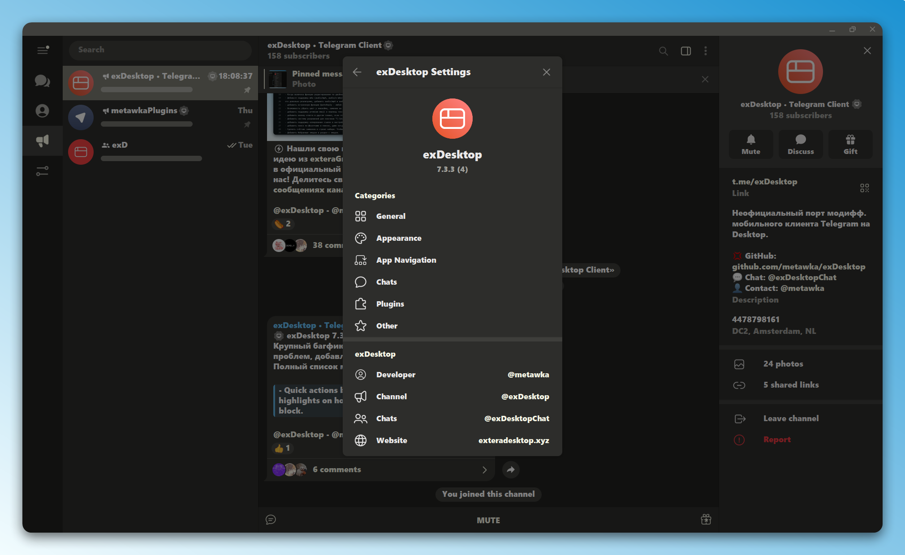
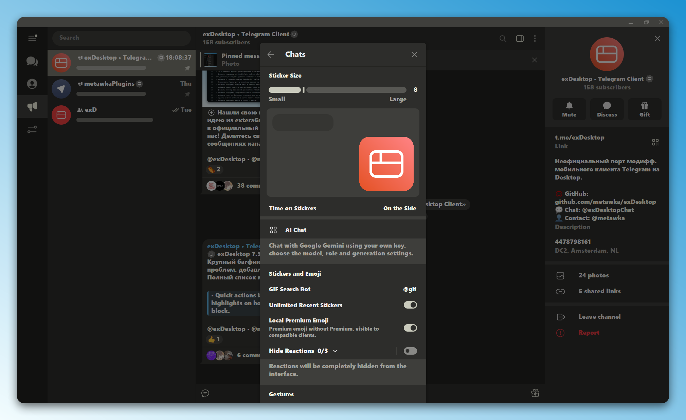
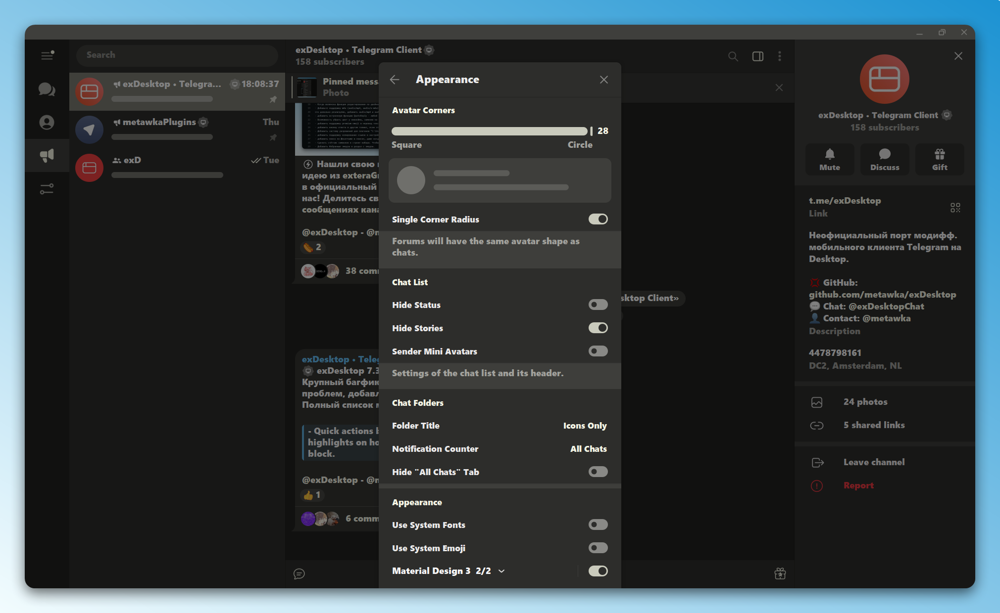
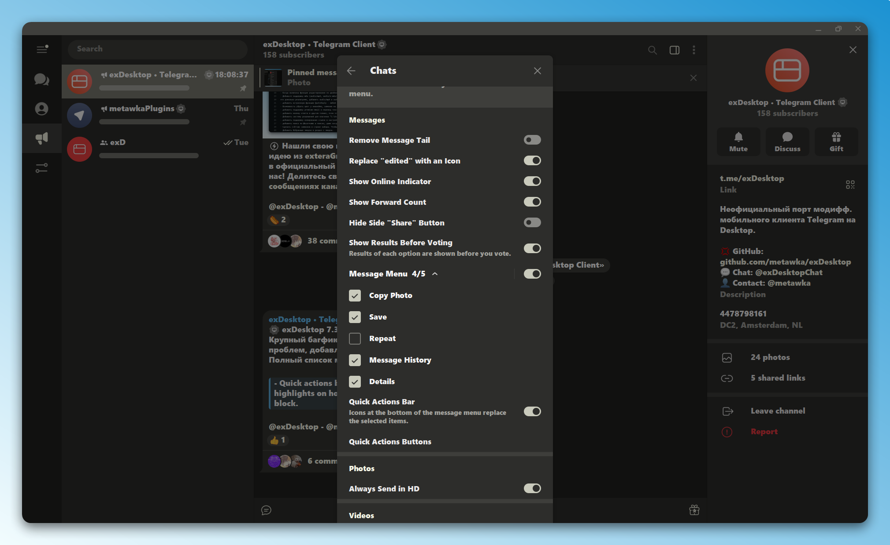
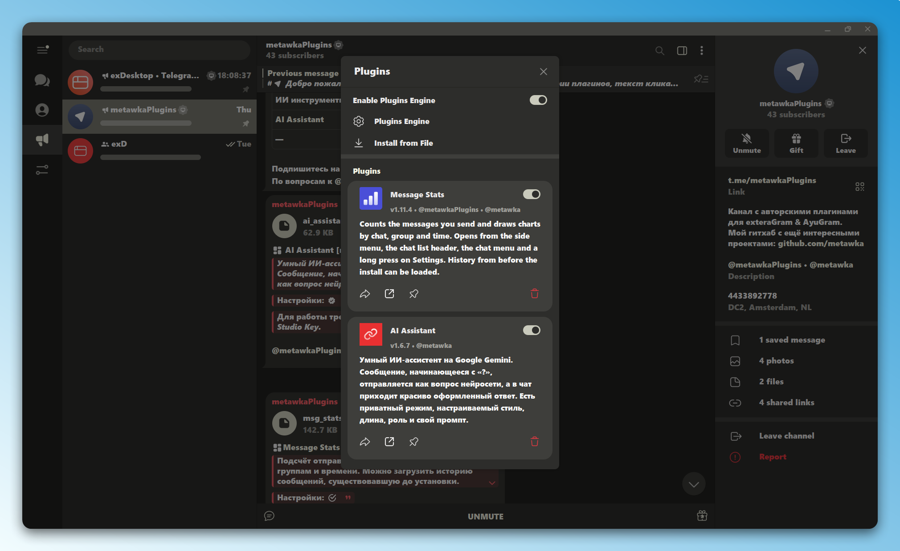

<p align="center">
  <a href="https://github.com/metawka/exDesktop/stargazers"></a>
</p>

<p align="center">
  
</p>

<h1 align="center">exDesktop</h1>

<p align="center">
  Неофициальный клиент Telegram для Windows, Linux и macOS на основе исходного кода
  <a href="https://github.com/telegramdesktop/tdesktop">Telegram Desktop</a>.<br>
  Функции exteraGram и других клиентов сообщества, адаптированные под Desktop.
</p>

<p align="center">
  <a href="https://github.com/metawka/exDesktop/releases/latest"></a>
  <a href="https://github.com/metawka/exDesktop/releases"></a>
  <a href="LICENSE"></a>
  <br>
  <a href="https://t.me/exDesktop"></a>
  <a href="https://t.me/exDesktopChat"></a>
  <a href="https://exteradesktop.xyz"></a>
</p>

<p align="center">
  <a href="README.md"></a>
  
</p>

<p align="center">
  
</p>

<table>
  <tr>
    <td width="50%"></td>
    <td width="50%"></td>
  </tr>
  <tr>
    <td width="50%"></td>
    <td width="50%"></td>
  </tr>
</table>

## Возможности

<table>
  <tr>
    <td width="50%" valign="top">
      <h3>Оформление</h3>
      <ul>
        <li>Элементы Material Design 3</li>
        <li>Настройка кастомных иконок</li>
        <li>Настройки элементов интерфейса и аватаров</li>
        <li>Размер стикеров</li>
        <li>Скрытие вкладки «Все чаты»</li>
        <li>Поддержка системных шрифтов и эмодзи</li>
      </ul>
    </td>
    <td width="50%" valign="top">
      <h3>Сообщения</h3>
      <ul>
        <li>Панель быстрых действий</li>
        <li>Детали</li>
        <li>Встроенный QuoteReply</li>
        <li>Отложенная отправка для редакторов каналов</li>
        <li>Пересылка сообщений с других аккаунтов</li>
        <li>Перевод сообщений с сохранением форматирования</li>
      </ul>
    </td>
  </tr>
  <tr>
    <td width="50%" valign="top">
      <h3>Ввод и медиа</h3>
      <ul>
        <li>Вычисления в поле ввода</li>
        <li>Счётчик символов</li>
        <li>Избранные эмодзи</li>
        <li>Порядок эмодзи-паков</li>
        <li>Локальные премиум-эмодзи</li>
        <li>Создание кружков из видео</li>
      </ul>
    </td>
    <td width="50%" valign="top">
      <h3>Приватность</h3>
      <ul>
        <li>Скрытие номера телефона</li>
        <li>Показ ID пользователей</li>
        <li>Показ даты регистрации</li>
        <li>Режим стримера</li>
        <li>Показ скрытых участников в группах</li>
        <li>Скрытие архива</li>
      </ul>
    </td>
  </tr>
  <tr>
    <td width="50%" valign="top">
      <h3>Сеть и уведомления</h3>
      <ul>
        <li>Встроенный tg-ws-proxy в Windows</li>
        <li>Ускорение загрузки и выгрузки</li>
        <li>Настройка визуала уведомлений</li>
        <li>Звук уведомлений</li>
        <li>Снятие лимита по кол-ву аккаунтов</li>
        <li>Автоматические обновления</li>
      </ul>
    </td>
    <td width="50%" valign="top">
      <h3>Плагины и ИИ</h3>
      <ul>
        <li>Движок плагинов на Python [в разработке]</li>
        <li>Настройки плагинов</li>
        <li>Экспорт плагинов</li>
        <li>Установка из файла</li>
        <li>ИИ-чат</li>
      </ul>
    </td>
  </tr>
</table>

## Загрузка

| Система | Файл |
|:--|:--|
| Windows | установщик `exDesktop-setup-x64.*.exe` или портативная версия `exDesktop-portable-x64.*.zip` |
| Linux | `exDesktop-linux-x64.*.tar.gz`, запуск файла `exDesktop` из архива |
| macOS | `exDesktop-macos-arm64.*.zip` для Apple Silicon |

Все файлы доступны на [странице релизов](https://github.com/metawka/exDesktop/releases/latest). exDesktop устанавливается рядом с Telegram Desktop и хранит данные отдельно.

## Сборка

<details>
<summary><b>Данные API</b></summary>

Собственные API ID и hash можно получить на [странице данных API Telegram](https://core.telegram.org/api/obtaining_api_id). Использование в CMake или скрипте configure при создании файлов проекта:

```bash
-D TDESKTOP_API_ID=YOUR_API_ID -D TDESKTOP_API_HASH=YOUR_API_HASH
```

</details>

<details>
<summary><b>Linux</b></summary>

**Зависимости**

- CMake 3.16 или новее и компилятор C++20 (GCC 12 или Clang 15 и новее)
- Qt 6: Core, Gui, Widgets, Network, OpenGL, DBus, Wayland, Svg, ImageFormats
- Заголовки Python от 3.11 до 3.14 для разработки (`python3-dev` / `dev-lang/python`)
- Библиотеки Telegram Desktop: `tg_owt`, `ffmpeg`, `openal`, `opus`, `rnnoise`, `libjpeg-turbo`, `xxhash`, `minizip`, `ada`, `cld3`, `wallet-engine-telegram`

**Сборка через CMake**

```bash
cmake -B build -G Ninja \
    -DCMAKE_BUILD_TYPE=Release \
    -DQT_VERSION_MAJOR=6 \
    -DDESKTOP_APP_DISABLE_QT_PLUGINS=ON \
    -DTDESKTOP_API_ID="YOUR_API_ID" \
    -DTDESKTOP_API_HASH="YOUR_API_HASH"

cmake --build build --target Telegram
```

**Gentoo**

```bash
emerge net-im/exdesktop
```

**Среда Python для плагинов**

Файлы среды копируются в `/usr/share/exDesktop/python/extera/` или лежат рядом с программой в `python/extera/`:

```bash
sudo mkdir -p /usr/share/exDesktop/python/extera
sudo cp -r Telegram/SourceFiles/extera/python/* /usr/share/exDesktop/python/extera/
```

</details>

<details>
<summary><b>Windows</b></summary>

1. Подготовка окружения по [инструкции сборки Telegram Desktop для Windows](https://github.com/telegramdesktop/tdesktop/blob/dev/docs/building-win.md).
2. Встраиваемая среда Python 3.11 размещается в `Libraries/win64/python311` вместе с заголовками, `python311.lib` и папкой `embed`.
3. Создание файлов проекта с вашими API ID и hash:

```cmd
python configure.py x64 -D TDESKTOP_API_ID=YOUR_API_ID -D TDESKTOP_API_HASH=YOUR_API_HASH
```

4. Сборка цели `Telegram`:

```cmd
cmake --build out --config Release --target Telegram
```

Для работы плагинов нужна папка `python` рядом с `Telegram.exe`.

</details>

## Локализация

Большая часть строк берётся из переводов Telegram Desktop. Строки exDesktop доступны на английском и русском.

## Благодарности

| Проект | Что используется в exDesktop |
|:--|:--|
| [Telegram Desktop](https://github.com/telegramdesktop/tdesktop) | Исходный код клиента |
| [exteraGram](https://github.com/exteraSquad/exteraGram) | Функции и формат плагинов |
| [AyuGram Desktop](https://github.com/AyuGram/AyuGramDesktop) | Примеры реализации для компьютера |
| [tg-ws-proxy](https://github.com/Flowseal/tg-ws-proxy) | Встроенный WebSocket-прокси, лицензия MIT |

## Лицензия

exDesktop распространяется по лицензии [GNU General Public License v3.0](LICENSE).